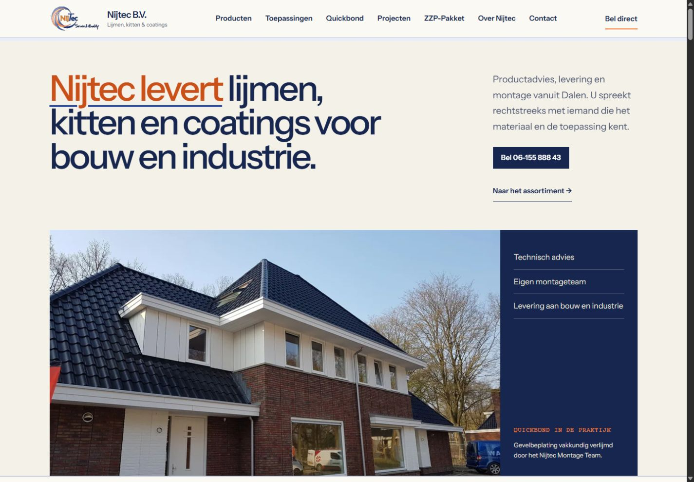

# Nijtec: beoordeling van voorstellen 02–12

Datum: 19 november 2026. Beoordeelde code: `3bb2836`, met uitsluitend lokale controlemiddelen en dit rapport erbovenop. Productie/main/dev zijn niet gewijzigd. Alle voorstellen blijven concept.

## Besluit voor publicatie

De voorgestelde verbeteringen zijn functioneel gecontroleerd. Er is geen bewijs dat elke mogelijke fout of prestatieterugval is uitgesloten. Publiceer pas na beoordeling van deze rapportage en de schriftelijke Quickbond-garantievoorwaarden. De extra snelheidsvergelijking wordt hieronder afzonderlijk vastgelegd.

## Voorstellen en volgorde

De PR's zijn gestapeld: iedere PR vergelijkt met de vorige reviewbranch; alleen PR 2 heeft main als basis. Ze zijn nog niet samengevoegd. Een individuele wijziging los overnemen vraagt controle van de afhankelijkheden.

| Opdracht | Voorstel | Concept-PR |
|---|---|---|
| 02 | Leesbare knoppen, labels en toetsenbordfocus | [#2](https://github.com/Damiank97/briqk-nijtec/pull/2) |
| 03 | Toepassingskaarten naar de juiste productpagina’s | [#3](https://github.com/Damiank97/briqk-nijtec/pull/3) |
| 04 | Consolideer typografie en prijsgetallen | [#4](https://github.com/Damiank97/briqk-nijtec/pull/4) |
| 05 | Benut het hero-paneel en vereenvoudig het ZZP-bestelblok | [#5](https://github.com/Damiank97/briqk-nijtec/pull/5) |
| 06 | Verduidelijk garantie en verwijder onduidelijke ISO-toeschrijving | [#6](https://github.com/Damiank97/briqk-nijtec/pull/6) |
| 07 | Maak berichtinvoer persoonlijk en verbeter formuliercontrast | [#7](https://github.com/Damiank97/briqk-nijtec/pull/7) |
| 08 | Maak het originele footerlogo leesbaar zonder merkbewerking | [#8](https://github.com/Damiank97/briqk-nijtec/pull/8) |
| 09 | Maak bestaande responsive beeldworkflow herhaalbaar | [#9](https://github.com/Damiank97/briqk-nijtec/pull/9) |
| 10 | Werk footerlinks, juridische kop en deelweergave af | [#10](https://github.com/Damiank97/briqk-nijtec/pull/10) |
| 11 | Vat bestaande projecten samen en begrens chatbotadvies | [#11](https://github.com/Damiank97/briqk-nijtec/pull/11) |
| 12 | Eindcontrole en resterende aandachtspunten | Deze PR |

## Functionele controle

- 80 geautomatiseerde tests slagen: bouw, bestaande URL's/media, SEO, juridische broninhoud, aanvraagcontext, contactadapter en chatbotgrenzen.
- 299 browsercontroles slagen: de homepage op 320/375/768/1440 px, de 16 overige routes op 390 px en het blog plus de twee productadviespagina's op 390/768/1440 px. Hieronder vallen layout/overlap, kaarten, fotovergroting, modal sluiten en focusherstel, formuliercontext, e-mailvalidatie, 3D-bediening en pauzeren/hervatten van echte WebGL-tekenacties.
- Handmatig: zichtbare toetsenbordfocus (3 px navy) op de desktopnavigatie; Enter op Oppervlak beschermen opent Coatings. De garantielink opent artikel 12 op de voorwaardenpagina, onder de vaste navigatie.
- Geen hamburgermenu aanwezig in dit ontwerp. Op smalle schermen blijft de belactie beschikbaar. Geen fictieve Esc-controle op een niet-bestaand menu; Esc op de aanwezige modals is wel getest.
- De preview verstuurt volgens het bestaande beleid geen echte e-mail. Succes, fout, herhaalde verzending en fallback zijn gesimuleerd getest. De productie-mailadapter is niet veranderd; ontvangst in André's mailbox is hier niet opnieuw getest.
- De browserproeven controleren de 3D-draglogica met pointer-events en toetsenbordbediening. Handmatige toetsenbordnavigatie is aanvullend gecontroleerd. Echte touchbediening op een fysieke telefoon is nog niet getest.

Ruwe gegevens: [browsercontroles](evidence/browser-checks.json), [schermmatrix](evidence/layout-matrix.json).

## Pagina × breedte

In alle 21 combinaties: geen horizontale overflow, belactie boven de vouw, gecontroleerde hoofdacties minstens 15 px en 44 px hoog, geen geregistreerde runtimefouten. Dit is een DOM/tekstmeting, aangevuld met de browserproeven en visuele steekproeven van homepage en contact. Het is geen volledige handmatige toegankelijkheidsaudit.

| Pagina | Breedte | Bevinding | Ernst |
|---|---:|---|---|
| / | 375 px | Past; belactie zichtbaar. Enkele kaart-/pakket-/hulpteksten 15 px; juridische accordiontekst deels 14 px. | should |
| /producten/ | 375 px | Past; belactie zichtbaar. Formulierhulp 15 px. | should |
| /producten/quickbond/ | 375 px | Past; belactie zichtbaar. Garantietoelichting en formulierhulp 15 px. | should |
| /projecten/ | 375 px | Past; belactie zichtbaar. Formulierhulp 15 px. | should |
| /zzp-pakket/ | 375 px | Past; belactie zichtbaar. Pakketintro en formulierhulp 15 px. | should |
| /contact/ | 375 px | Past; belactie zichtbaar. Formulierhulp 15 px. | should |
| /algemene-voorwaarden/ | 375 px | Past; belactie zichtbaar. Formulierhulp 15 px. | should |
| / | 768 px | Past; belactie zichtbaar. Enkele kaart-/pakket-/hulpteksten 15 px; juridische accordiontekst deels 14 px. | should |
| /producten/ | 768 px | Past; belactie zichtbaar. Formulierhulp 15 px. | should |
| /producten/quickbond/ | 768 px | Past; belactie zichtbaar. Garantietoelichting en formulierhulp 15 px. | should |
| /projecten/ | 768 px | Past; belactie zichtbaar. Formulierhulp 15 px. | should |
| /zzp-pakket/ | 768 px | Past; belactie zichtbaar. Pakketintro en formulierhulp 15 px. | should |
| /contact/ | 768 px | Past; belactie zichtbaar. Formulierhulp 15 px. | should |
| /algemene-voorwaarden/ | 768 px | Past; belactie zichtbaar. Formulierhulp 15 px. | should |
| / | 1440 px | Past; belactie zichtbaar. Enkele kaart-/pakket-/hulpteksten 15 px; juridische accordiontekst deels 14 px. | should |
| /producten/ | 1440 px | Past; belactie zichtbaar. Formulierhulp 15 px. | should |
| /producten/quickbond/ | 1440 px | Past; belactie zichtbaar. Garantietoelichting en formulierhulp 15 px. | should |
| /projecten/ | 1440 px | Past; belactie zichtbaar. Formulierhulp 15 px. | should |
| /zzp-pakket/ | 1440 px | Past; belactie zichtbaar. Pakketintro en formulierhulp 15 px. | should |
| /contact/ | 1440 px | Past; belactie zichtbaar. Formulierhulp 15 px. | should |
| /algemene-voorwaarden/ | 1440 px | Past; belactie zichtbaar. Formulierhulp 15 px. | should |

Deze 14–15 px teksten voldoen nog niet overal aan het aangeleverde streefminimum van 16 px voor lopende tekst. Ze zijn in deze rapportagestap niet verder gewijzigd. Hoofdtekst, projectbeschrijvingen en formulierinvoer zijn groter. Geen clipping waargenomen in de gecontroleerde onderdelen; de bestaande tests dekken niet iedere mogelijke tekstcombinatie of vertaling.

## Contrast en beeld

De meting van zichtbare tekstkleuren op de berekende achtergronden vindt één paar onder 4,5:1: display-oranje `#c95018` op papier `#f4f1e9`, 4,01:1, in de H1 op 42/50/73 px. Dat is grote tekst en voldoet aan 3:1; de H1 is behouden. Geen aanvullend tekstpaar onder 4,5:1 gevonden in de 21 paginaweergaven. Op beelden, gradients, hover en samengestelde transparantie is een automatische berekening geen volledig bewijs; de hoofdweergaven zijn ook bekeken.

- Formulierplaceholder `#c8cfe0` op het navy veld: circa 7,06:1.
- Kleine accenttekst gebruikt de bestaande donkere oranjevariant; oorspronkelijk oranje blijft op navy mogelijk. Dit is grotendeels bestaand werk, geen nieuwe besparing.
- De nieuwe hovercombinatie wit op `#a23c11` is circa 6,58:1.
- Het originele header-/footerlogo is niet bewerkt of opnieuw getekend. Een vectorbron ontbreekt; zie [logo](08-logo.md).
- Deelbeeld: 1200 × 630 px, 103.774 bytes. Originele foto-URL's en het bestaande responsive WebP-manifest blijven behouden.

## Snelheid

Dezelfde Lighthouse-versie (13.5.0), mobiele standaardinstellingen, dezelfde computer, identieke lokale statische server en dezelfde vlaggen (`--headless --disable-gpu`); metingen achtereen uitgevoerd. Baseline is productiecommit `d9dd1c3` in een tijdelijke, afzonderlijke kopie. Voorstel is `3bb2836`.

| Versie / ronde | Performance | Accessibility | Best Practices | SEO | LCP | TBT | CLS |
|---|---:|---:|---:|---:|---:|---:|---:|
| Baseline 1 | 82 | 100 | 96 | 100 | 4,51 s | 109 ms | 0 |
| Voorstel 1 | 83 | 100 | 96 | 100 | 4,43 s | 0 ms | 0 |
| Baseline 2 | 81 | 100 | 96 | 100 | 4,58 s | 108 ms | 0 |
| Voorstel 2 | 80 | 100 | 96 | 100 | 4,64 s | 115 ms | 0 |

Beide versies gemiddeld 81,5 Performance; de rondes laten geen duidelijke systematische terugval zien. Twee metingen per versie bewijzen geen gelijkwaardigheid. LCP blijft in deze mobiele labsimulatie een aandachtspunt. De 96 voor Best Practices komt bij beide uitsluitend van de ontbrekende `/api/contact`-route in de statische vergelijkingsserver; de werkelijke QA-server heeft die route en scoort daar 100.

Het afbeeldingsverkeer bij de eerste mobiele paginalading is in beide versies exact 663.860 bytes over vijf verzoeken (circa 0,66 MB), onder het aangeleverde doel van 1,5 MB. De nieuwe deelafbeelding wordt niet als paginabeeld geladen. Geen beeldbesparing door deze voorstellen geclaimd.

Voor transparantie: een eerdere losse productie-audit gaf 87/100/100/100 en een losse lokale QA-audit 59/100/100/100. Dat zijn andere hosts/serveeromstandigheden; de productie-audit waarschuwde bovendien voor CPU-kalibratie. Die twee uitkomsten zijn niet geschikt als voor/na-bewijs. Daarom bovenstaande gepaarde vergelijking uitgevoerd. Alle scores zijn labmetingen op deze computer, geen echte-bezoekersdata, SEO-ranking of garantie. Controleer vóór publicatie nogmaals onder stabiele omstandigheden op de bedoelde deployment.

Samengevatte meetgegevens staan in [Lighthouse-resultaten](evidence/lighthouse-summary.json).

## Nog nodig en voorgestelde losse vervolgopdrachten

| Prioriteit | Opdracht | Gereed wanneer |
|---|---|---|
| must voor publicatie van garantieclaim | André bevestigt de schriftelijke Quickbond-garantie: verstrekker, toepassingsbereik, duur, beperkingen en bewijs. Artikel 12 bewijst op zichzelf geen tienjaarsgarantie. | Exacte claim en voorwaarden sluiten aantoonbaar op elkaar aan. |
| should | Verhoog lopende kaart-, pakket-, garantie- en formulierhulptekst naar minstens 16 px; controleer ook de juridische accordiontekst. | Nieuwe 375/768/1440-controle zonder afkapping of verschoven hoofdacties. |
| should | Test 360° slepen op een fysieke iPhone/Android, inclusief scrollen, terugkeren en bediening met vergrote tekst. | Draait met touch, blokkeert pagina-scroll niet onnodig en kan worden hersteld. |
| should | Laat André de drie projectdossiers aanvullen met vraag, exacte werkzaamheden/producten, datum en bevestigd resultaat. | Alleen bevestigde feiten en toegestane quotes publiceren. |
| nice | Vraag Ready4it/André om het oorspronkelijke vectorlogo. | Bronbestand ontvangen; behoud merkafspraak en slogan. |
| nice vóór eventuele chatbotactivering | Doe aparte inhoudelijke en beveiligingsbeoordeling van de verborgen chatbot, inclusief langere gesprekken. | Geen definitief toepassingsadvies; goedgekeurde kennis, doorverwijzing en grenzen aantoonbaar. |

ISO is uit de onduidelijke publieke claim verwijderd. Terugplaatsen vereist bewijs van de gecertificeerde rechtspersoon, instelling, nummer en geldigheid. Zie [claims](06-claims.md) en [projectvragen](11-projects.md). Geen ontbrekende feiten als TODO op de website gezet.

## Bewijs en toegang

[Mobiel voorstel](screenshots/mobile.jpg) · [Tabletcontact](screenshots/tablet-contact.jpg)

Vercel meldt een geslaagde previewbuild voor PR 11. De preview verwijst bij browserbezoek naar aanmelden. De automatische goedkeuringscontrole heeft openen van het Vercel-dashboard geblokkeerd wegens mogelijke privé account-/projectgegevens. Daarom is dezelfde code lokaal beoordeeld; er zijn geen toegangsinstellingen gewijzigd. De eigenaar kan de preview zelf via Vercel bekijken.

De oorspronkelijke logo-assets, juridische bronarchieven, productie-contactadapter, bestaande canonicals/H1-teksten en sitemaproutes zijn behouden. Geen extra analytics-events, geen nieuw frontendframework en geen herintroductie van vervallen assortimenten. Dit rapport voert geen extra productiewijzigingen door.
